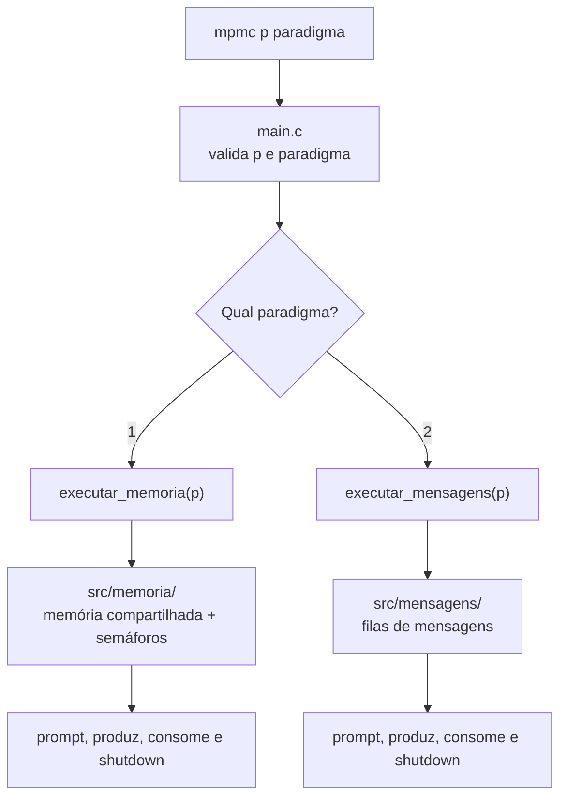

# mpmc-unb

Implementação do problema de múltiplos produtores e múltiplos consumidores usando memória compartilhada, semáforos e filas de mensagens em C.

## Integrantes

| Nome | Matrícula |
|---|---|
| Bianca Neves da Silva | 231013583 |
| Guilherme Ribeiro de Macedo | 170162354 |
| João Lucas Araújo França | 190015187 |
| Mateus Gomes de Araújo | 202014440 |
| Matheus Lacerda da Silveira | 201000136 |

## Arquitetura

O projeto gera um único programa final, `mpmc`. O `main` é responsável apenas por validar os argumentos iniciais e encaminhar a execução para o paradigma selecionado. Depois disso, cada módulo controla seu próprio prompt, processos, mecanismos IPC, estatísticas e encerramento.



Os módulos são independentes. A integração entre as duas frentes acontece somente pelas funções públicas declaradas em `include/memoria.h` e `include/mensagens.h`.

## Estrutura de diretórios

```text
mpmc-unb/
├── include/
│   ├── memoria.h
│   ├── memoria_interno.h
│   └── mensagens.h
├── src/
│   ├── main.c
│   ├── memoria/
│   │   ├── memoria.c
│   │   ├── memoria_buffer.c
│   │   └── memoria_ops.c
│   └── mensagens/
│   │   └── mensagens.c
├── .gitignore
├── Makefile
└── README.md
```

## Requisitos

- sistema operacional Unix;
- compilador compatível com C17, como o GCC;
- GNU Make;
- mecanismos IPC System V para memória compartilhada, semáforos e filas de mensagens.

## Compilação

| Comando | Ação |
|---|---|
| `make` | compila os dois paradigmas e gera `build/mpmc` |
| `make clean` | remove os arquivos gerados |

## Execução

```bash
./build/mpmc <p> <paradigma>
```

- `p`: quantidade de estruturas de produção, devendo ser maior que zero;
- `paradigma`: `1` para memória compartilhada ou `2` para troca de mensagens.

O programa também pode ser iniciado em segundo plano:

```bash
./build/mpmc <p> <paradigma> &
```

## Comandos

### Produção

```text
produz <p> <n_msgs> <ack> &
```

- `p`: estrutura que receberá as mensagens, entre `1` e a quantidade informada na execução;
- `p = 0`: distribui as mensagens entre todas as estruturas no padrão striped;
- `n_msgs`: número de mensagens produzidas, entre `1` e `1024`;
- `ack = 1`: o produtor espera todas as suas mensagens serem consumidas;
- `ack = 2`: o produtor não espera confirmação.

### Consumo

```text
consome <p> <n_msgs> <ack> &
```

- `p`: estrutura da qual as mensagens serão retiradas, entre `1` e a quantidade informada na execução;
- `n_msgs`: número de mensagens solicitadas, entre `1` e `1024`;
- `ack = 1`: o consumidor espera até consumir todas as mensagens solicitadas;
- `ack = 2`: o consumidor retorna caso não existam mais mensagens disponíveis.

### Encerramento

```text
shutdown
```

O encerramento termina os processos, apresenta os tempos de execução e os totais consumidos e remove os mecanismos IPC utilizados.

## Exemplos

### Memória compartilhada

```text
./build/mpmc 2 1
>> produz 1 3 1 &
>> consome 1 3 1 &
>> shutdown
```

### Troca de mensagens

```text
./build/mpmc 2 2
>> produz 0 4 2 &
>> consome 1 2 1 &
>> consome 2 2 1 &
>> shutdown
```
