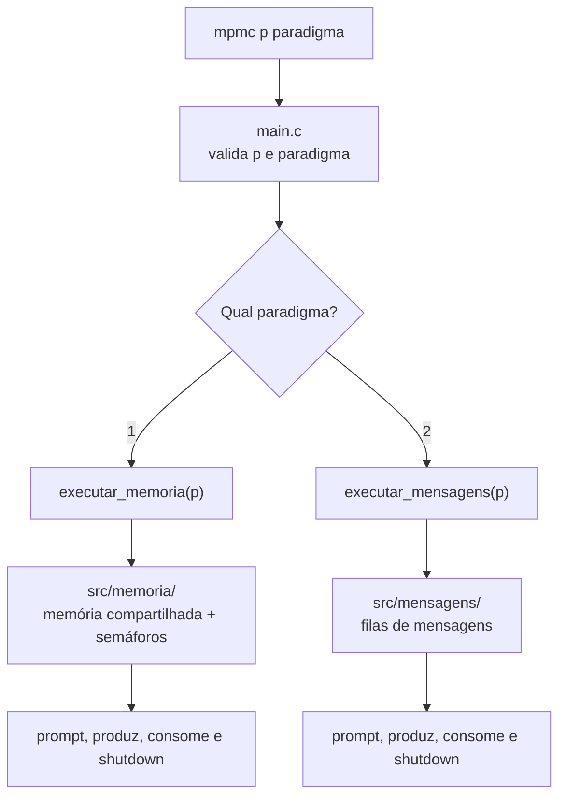

# mpmc-unb

Implementação do problema de múltiplos produtores e múltiplos consumidores usando memória compartilhada, semáforos e filas de mensagens em C.

## Arquitetura

O projeto gera um único programa final, `mpmc`. O `main` é responsável apenas por validar os argumentos iniciais e encaminhar a execução para o paradigma selecionado. Depois disso, cada módulo controla seu próprio prompt, processos, mecanismos IPC, estatísticas e encerramento.



Os módulos são independentes. A integração entre as duas frentes acontece somente pelas funções públicas declaradas em `include/memoria.h` e `include/mensagens.h`.

## Estrutura de diretórios

```text
mpmc-unb/
├── include/
│   ├── memoria.h
│   ├── memoria_interno.h
│   └── mensagens.h
├── src/
│   ├── main.c
│   ├── memoria/
│   │   ├── memoria.c
│   │   ├── memoria_buffer.c
│   │   └── memoria_ops.c
│   └── mensagens/
│   │   └── mensagens.c
├── .gitignore
├── Makefile
└── README.md
```

## Compilação

| Comando | Ação |
|---|---|
| `make` | compila os dois paradigmas e gera `build/mpmc` |
| `make clean` | remove os arquivos gerados |
